# Freeze Tag

## Project Overview

Freeze Tag is a browser-based training simulator for The Ohio State University
College of Nursing. Student workers and research lab staff can practice finding
samples before working with a physical research freezer. Lab managers can model
their own freezers and use those layouts to create timed training exercises.

Each virtual freezer can hold up to four shelves and six racks per shelf. A
rack has a 4 × 4 grid of box slots. Each box has a 9 × 9 grid of sample
positions labeled `A1` through `I9`.

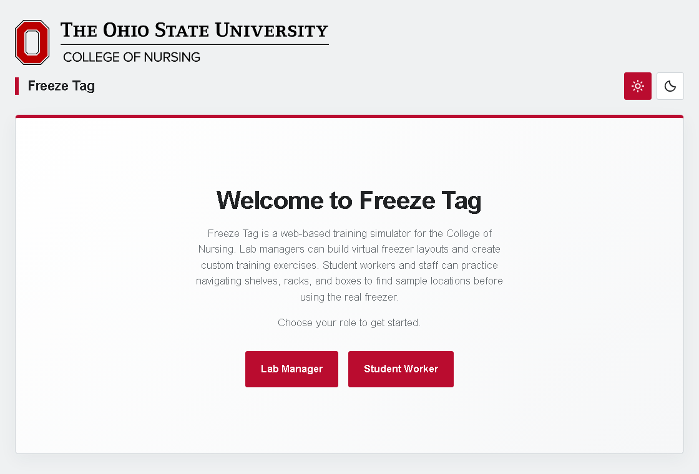

## Quick start

Use Node.js 24 and npm. From the repository root, run the following commands.

```sh
npm ci
npm start
```

Open the local URL shown in the terminal, then choose
**Student Worker → Tutorial Mode** to practice immediately with the built-in
freezer. Press `Ctrl+C` to stop the server when you’re done.

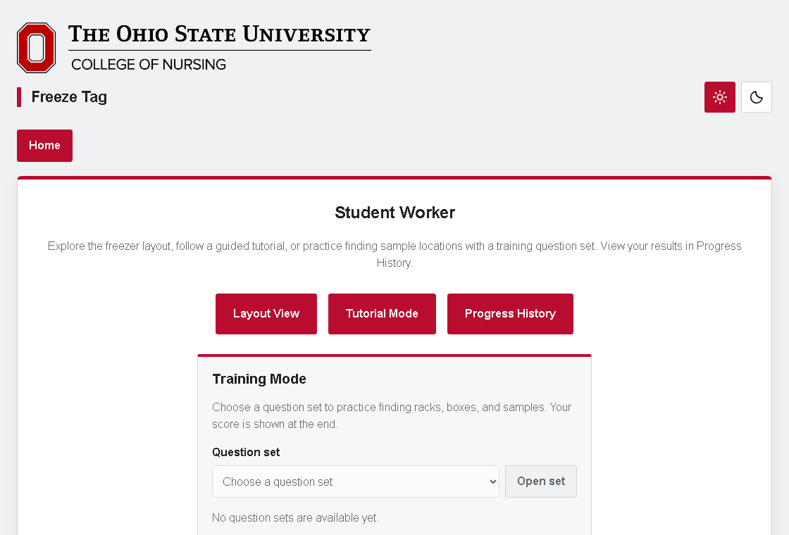

## App preview

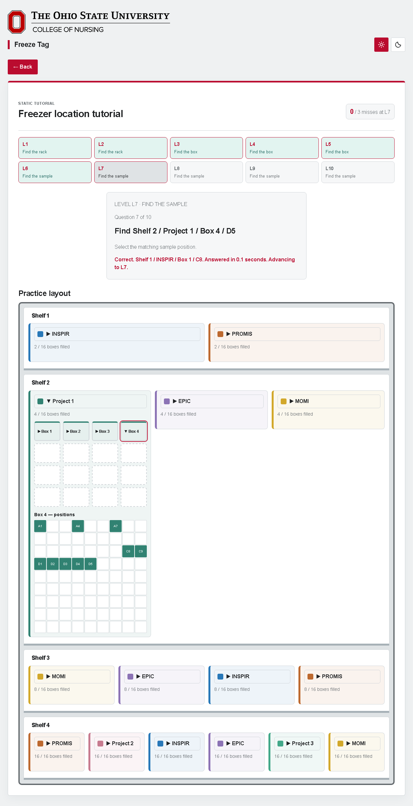

## Using Freeze Tag

### Student Worker

- **Layout View** opens saved freezers in read-only mode. Expand shelves, racks,
  and boxes to inspect sample positions. Use **Expand All Shelves** or
  **Collapse All Shelves** to change the entire shelf view at once.
- **Tutorial Mode** draws one question per level across 10 levels in a practice
  freezer. A correct answer advances to the next level. Three misses on one
  level reveal the answer and draw a new question sequence starting at level one.
  The tutorial shows your total time when you finish.
- **Training Mode** uses a lab manager’s saved layout and question set. Pick a
  set and select **Open set**. Find the requested rack, box, or sample position
  to earn a point, then select **Next question** or **See results**. Three
  misses on a question or an expired timer records a failed attempt and
  restarts the set from the beginning. After completing the set, review your
  score and misses or choose **Run set again**. Use **Change set** to return to
  the picker during or after a run.

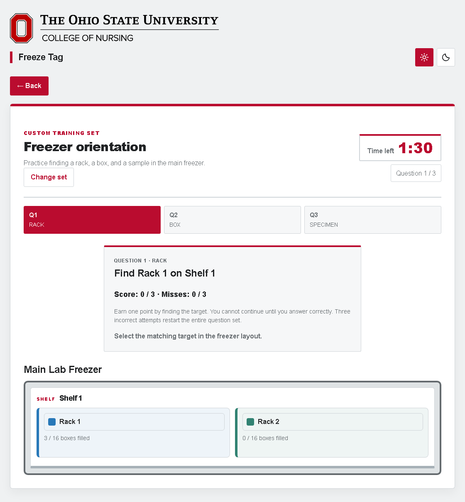

### Progress History

Both roles can review the browser’s latest 100 question-set attempts, including
completed runs and runs that ended after three misses or an expired timer. The
history shows completion rate, best time per set, scores, and per-question
times and misses. **Clear history** removes saved attempts after confirmation.

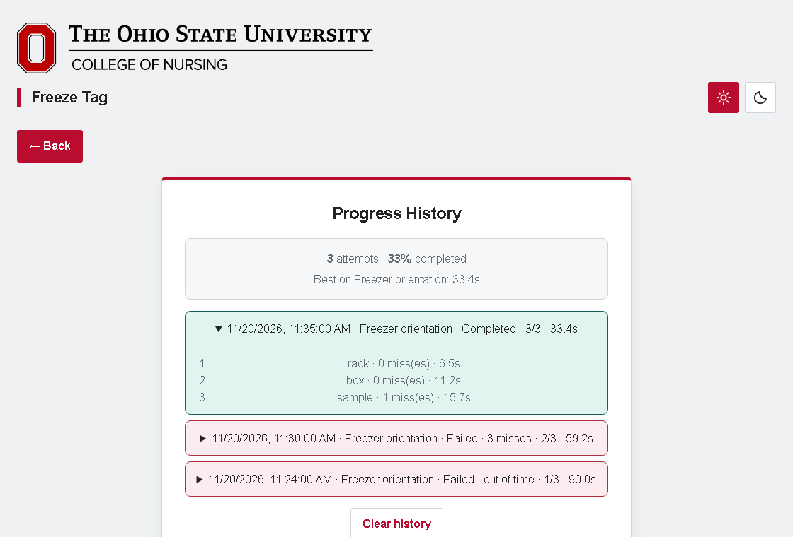

### Lab Manager

Select **Lab Manager** and enter the password for the current browser. Use
**Settings** on the Lab Manager home screen to change it and **Logout** to end
the session. For a fresh local installation, see the default in the
[authentication settings](src/state/authState.ts).

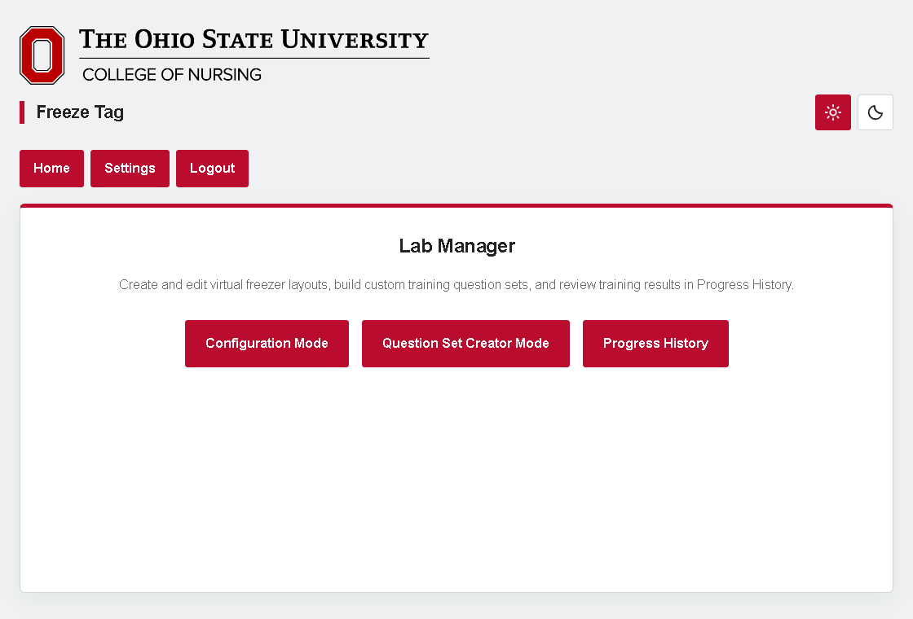

#### Configure a freezer

Open **Configuration Mode → + Add Freezer**. Choose **Create New** to build a
layout or **Upload Layout** to import a JSON file. Name the layout and select
**Save** in the editor. Select an existing layout from the dashboard to edit it,
or use **Delete** in the editor to remove it. To try an import, use the
[example freezer layout](src/data/sample-freezer-layout.json).

- **Layout editing** supports adding and removing shelves, racks, and boxes,
  assigning or clearing samples, and renaming racks, boxes, and samples. Choose
  rack and box colors from the palette or set a box to **Match rack color**.
- **Drag and drop** reorders racks or moves them to another shelf. Drag a box
  within its rack to move it into an empty slot or swap it with another box.
- **Cut, copy, and paste** work within and between saved freezers. Click a shelf,
  rack, or box, press `Ctrl+X` or `Ctrl+C`, then hover over the destination and
  press `Ctrl+V`. Use `Command` instead of `Ctrl` on macOS. Pasting shelf contents
  onto an occupied shelf asks before replacing its racks. To place a box, hover
  over an empty slot or paste into the rack to use its first available slot.
- **Bulk Fill** opens a grid to fill a rack with boxes or a box with samples.
  Choose the target, enter names, and select **Update**. Clearing an occupied
  cell removes its contents on update. Duplicate names prompt for confirmation.

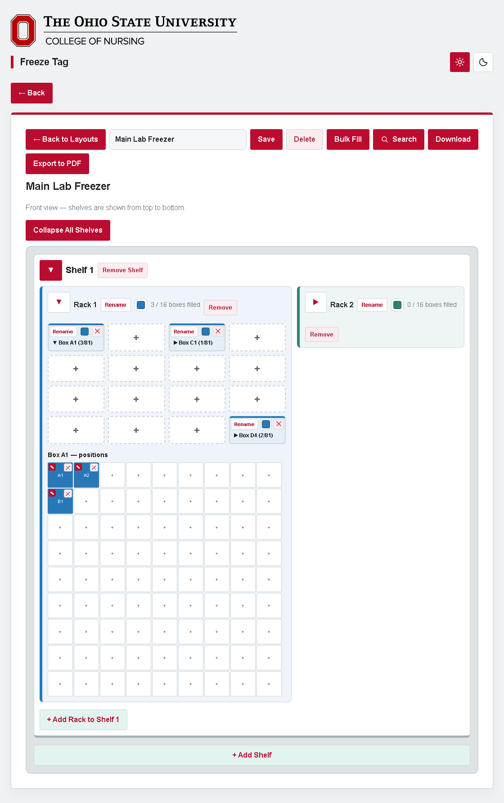

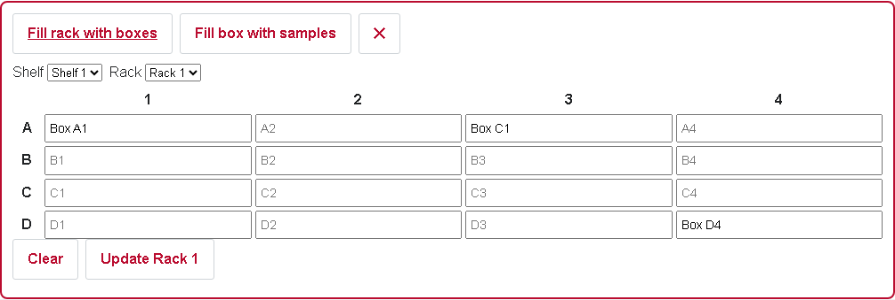

#### Create a timed question set

1. Open **Question Set Creator Mode** and choose **Create question set**. Enter
   a name, select a saved source layout, and set the time limit in whole minutes
   and seconds. The default is two minutes. You can also add instructions.
2. Add at least one question. For each question, choose a rack, box, or sample
   position, and write a prompt. Use the arrows to reorder questions or
   **Remove** to delete one from the draft.
3. Select **Save question set**. Saved sets can be edited or deleted from the
   creator screen. To try a saved set, return to the welcome screen through
   **Home** and choose **Student Worker → Training Mode**.

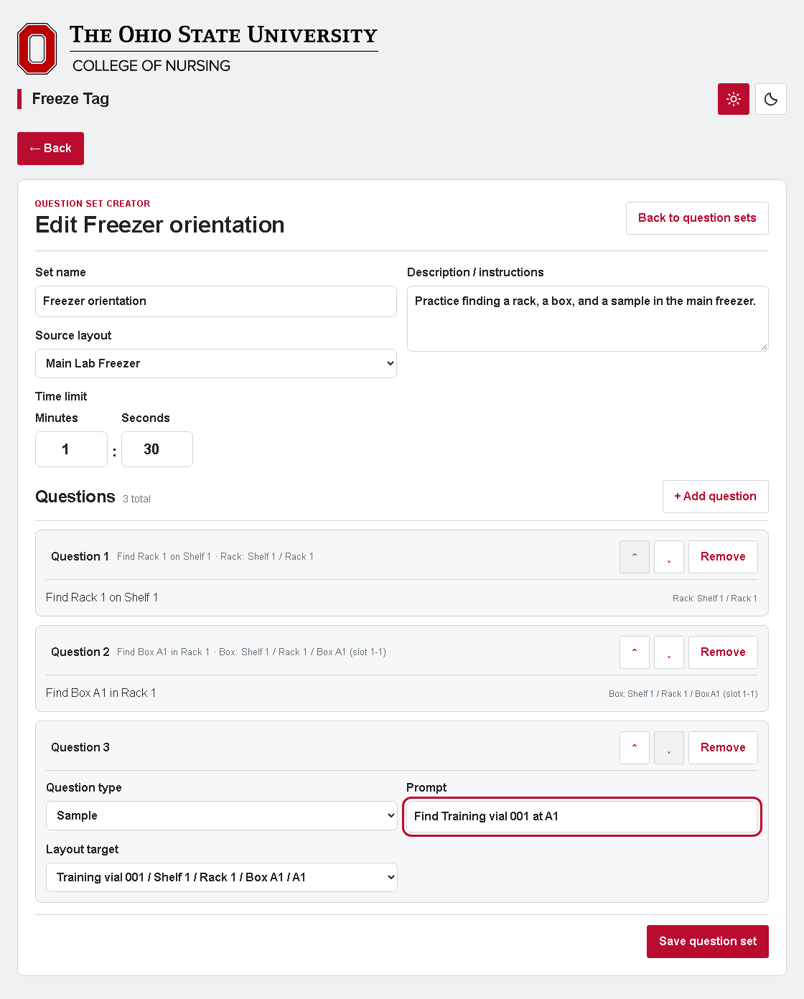

## Export and share layouts

Open a layout in either role and select **Download** for a reusable JSON file.
To print it, select **Export to PDF**, choose **Current layout** or
**One shelf per page**, then select **Save as PDF** in the browser print dialog.
Freeze Tag remembers the last PDF layout choice.

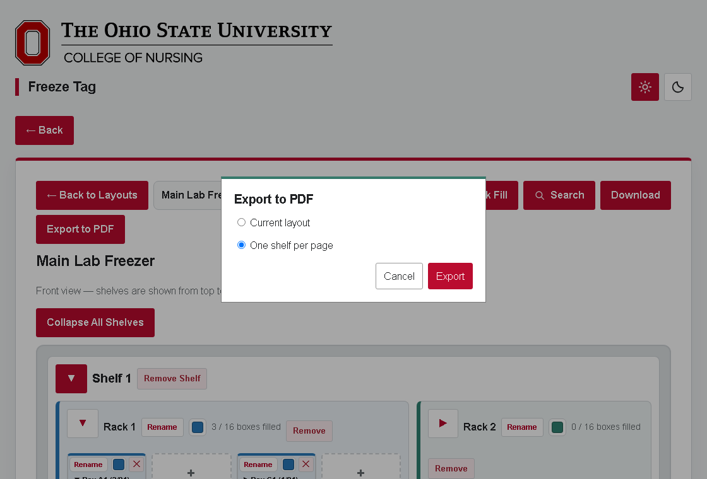

## Layout search

Select **Search** in **Layout View** or **Configuration Mode**. Enter all or
part of a layout, freezer, shelf, rack, box, or sample name, or a position such
as `A1`. Select **Find** or press Enter. Search ignores capitalization and
surrounding spaces.

From the layout list, search covers all saved layouts. Inside an open layout, it
covers that layout and includes unsaved edits in Configuration Mode. Each result
shows its full location. Selecting a result opens the path and highlights and
focuses the matching item. Samples stored in multiple positions appear once per
location.

Close the panel or press `Esc` to hide it and preserve results. Select **Clear**
or leave the layout to reset the search and highlighting.

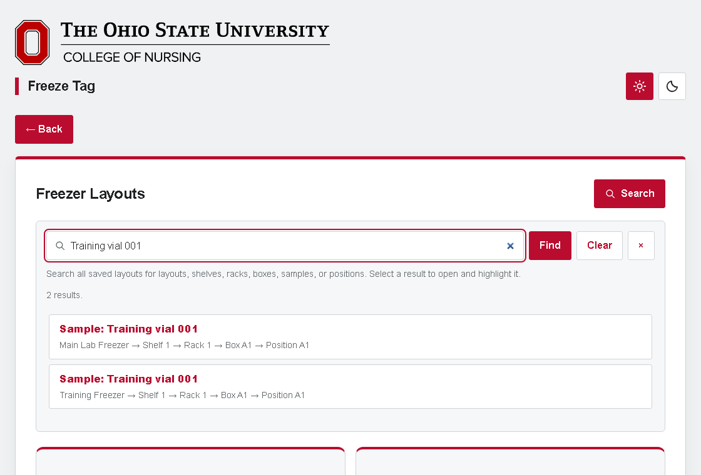

## Application themes

Use the sun or moon icon in the header to switch between light and dark mode.
Light mode is the default, and you choose the theme independently of your
device setting. The browser remembers your choice when storage is available.
Switching themes preserves training progress and open racks and boxes.

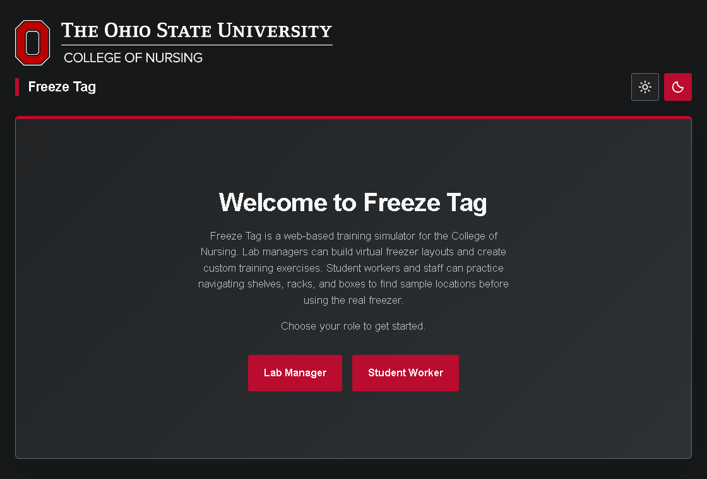

## Browser storage

Freeze Tag runs in the browser. Layouts, question sets, attempt history, and
settings are saved locally for the current browser profile and site address.
Create and run a question set using the same browser profile and address. To
move a layout to another browser, download its JSON and import it there. The
layout file contains the freezer structure and samples. Question sets and
attempt history stay in the original browser.

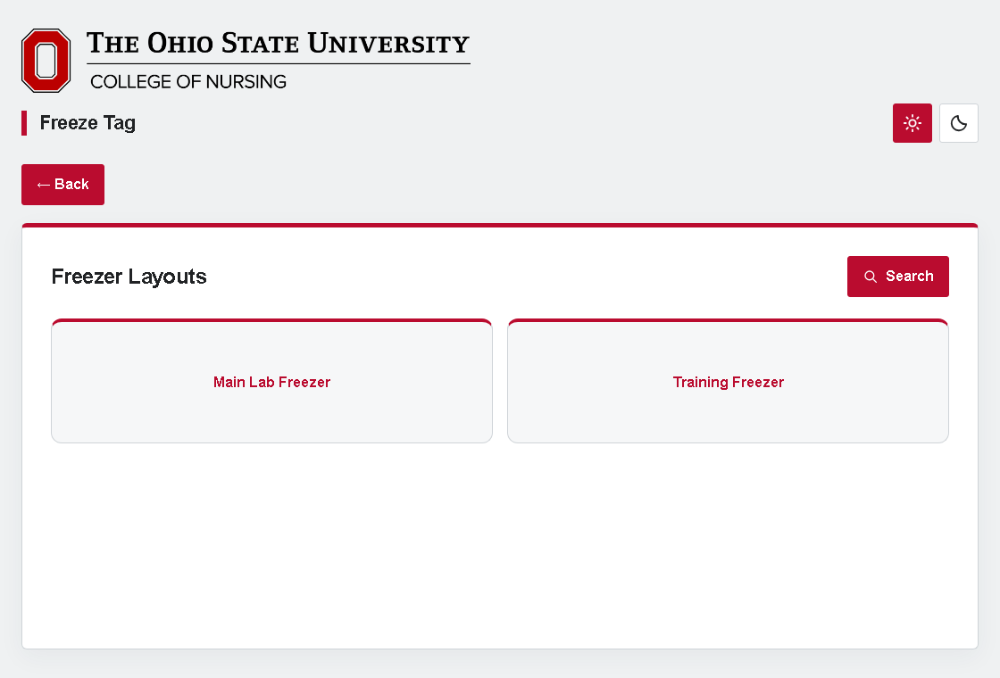

## Development

| Command | Purpose |
| --- | --- |
| `npm start` | Start the Parcel development server with output in `.parcel-dev/`. |
| `npm test -- --run` | Run Vitest unit and integration tests once. |
| `npx playwright install chromium` | Install Chromium for browser tests. |
| `npm run test:browser` | Run Playwright tests in light and dark mode at 360 px and 1100 px. |
| `npm run build` | Build the GitHub Pages site in `dist/`. |
| `npm run gen:types` | Regenerate the TypeScript types from the freezer layout JSON schema. |

Playwright starts the app automatically. Set `PLAYWRIGHT_CHANNEL` to `chrome` or
`msedge` to use an installed browser.

### Project structure

| Path | Contents |
| --- | --- |
| `index.html`, `src/index.ts`, `src/styles.css` | Browser entry point and shared styles. |
| `src/render/`, `src/state/` | TypeScript views and application state. |
| `src/services/` | Layout editing, search, validation, training targets, and browser storage. |
| `src/models/`, `src/data/` | TypeScript models, JSON schema, and example layout. |
| `test/` | Vitest unit and integration suites and Playwright browser tests. |
| `.github/workflows/` | Automated testing and GitHub Pages deployment. |

### GitHub Actions

GitHub Actions is configured to run Vitest and Playwright on pull requests and
pushes to `main`. On pushes to `main`, it also tests, builds, and publishes
`dist/` to GitHub Pages under `/FreezeTag.con-osu/`.
[Test workflow](.github/workflows/test.yml) ·
[Deployment workflow](.github/workflows/deploy.yml)

Both workflows currently select Node.js 20. The pinned Vitest version requires
a newer supported Node.js version, so local setup uses Node.js 24.

## Documentation

- [Freezer layout schema](docs/freezer-layout-schema.md) explains the JSON
  structure used for imports and exports.
- [Training target model](docs/training-mode.md#shared-question-target-contract)
  explains how questions link to racks, boxes, and sample positions.
- [Visual review](docs/screenshots/README.md) records the light and dark theme
  redesign.

## License

The package metadata lists ISC. [Package metadata](package.json)
